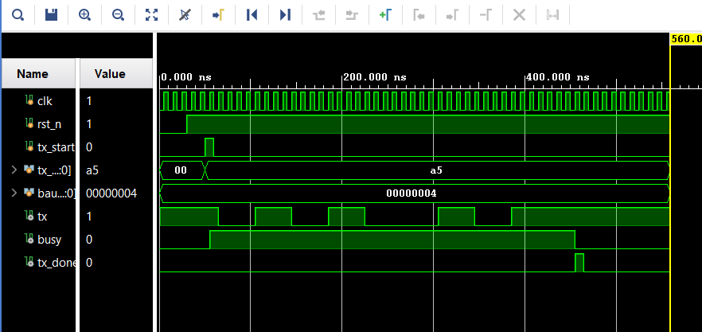
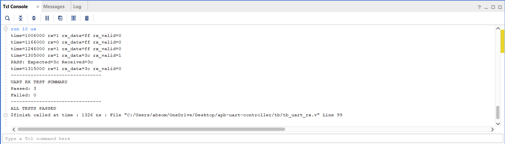
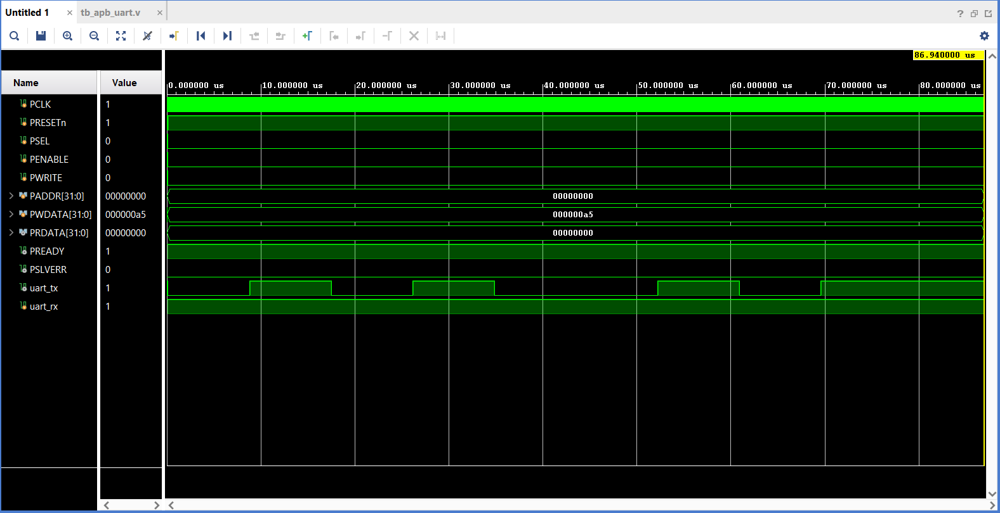
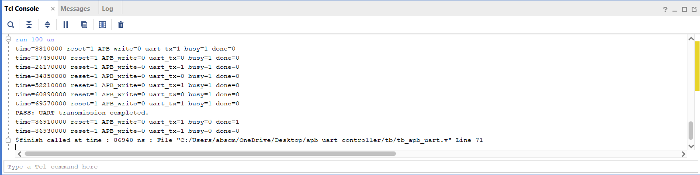
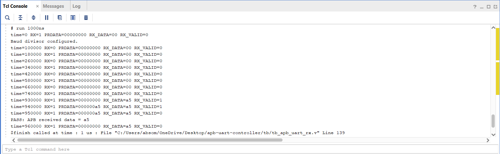

# APB-Based UART Controller Using Verilog HDL

## Overview

This project implements an **APB-based UART (Universal Asynchronous Receiver/Transmitter) controller** using Verilog HDL.

The design integrates an AMBA APB slave interface with UART transmitter and receiver modules. It allows a bus master to configure the baud-rate divisor, transmit data, and read received data through memory-mapped registers.

The design was developed and simulated using **AMD Vivado 2025.2**.

## Features

- APB slave interface for register-based communication.
- UART transmitter supporting 8-bit serial data transmission.
- UART receiver supporting 8-bit serial data reception.
- Least Significant Bit (LSB) first data transmission.
- Configurable baud-rate divisor.
- Memory-mapped DATA, STATUS, CTRL, BAUDDIV, and VERSION registers.
- Standalone and APB-integrated simulation testbenches.

## UART Frame Format

The UART uses the following frame format:

| Field | Description |
|---|---|
| Start bit | Logic 0 |
| Data bits | 8 bits, LSB first |
| Parity bit | Not implemented |
| Stop bit | Logic 1 |

The implemented configuration is **8-N-1**: 8 data bits, no parity, and 1 stop bit.

## Architecture

The design consists of three main modules:

1. **APB Interface (`apb_uart.v`)** – Handles APB read and write transactions and provides access to the UART registers.
2. **UART Transmitter (`uart_tx.v`)** – Converts parallel data into serial UART frames.
3. **UART Receiver (`uart_rx.v`)** – Receives serial UART data and converts it into parallel data.

## Register Map

| Address Offset | Register | Description |
|---|---|---|
| `0x00` | DATA | Transmit and receive data register |
| `0x04` | STATUS | Transmitter busy and receiver valid status |
| `0x08` | CTRL | Control register |
| `0x0C` | BAUDDIV | Baud-rate divisor register |
| `0x10` | VERSION | Design version register |

### Register Description

- **DATA (`0x00`):** Writing a byte initiates UART transmission when the transmitter is not busy. Reading returns the received UART data.
- **STATUS (`0x04`):** Bit 0 indicates transmitter busy, and bit 1 indicates receiver data valid.
- **CTRL (`0x08`):** Stores the control-register value. Functional transmitter and receiver enable control is not implemented yet.
- **BAUDDIV (`0x0C`):** Configures the baud-rate divisor. The default value is 434.
- **VERSION (`0x10`):** Returns `0x00010000`.

## Project Directory Structure

```text
apb-uart-controller/
│
├── rtl/
│   ├── apb_uart.v
│   ├── uart_tx.v
│   └── uart_rx.v
│
├── tb/
│   ├── tb_uart_tx.v
│   ├── tb_uart_rx.v
│   ├── tb_apb_uart.v
│   └── tb_apb_uart_rx.v
│
├── sim/
│   ├── uart_tx_simulation_result.png
│   ├── uart_rx_simulation_result.png
│   ├── apb_uart_integration_waveform.png
│   ├── apb_uart_integration_console.png
│   └── apb_uart_rx_integration_result.png
│
├── docs/
│   ├── spec.md
│   └── register_map.md
│
└── README.md
```

*Make sure the filenames above match the files actually present in your repository.*

## Verification and Simulation Results

The design was verified using Verilog testbenches in AMD Vivado 2025.2.

### 1. UART Transmitter Test

The transmitter was tested independently to verify serial data transmission.

**Result:** PASS

### 2. UART Receiver Test

The receiver was tested with three different data patterns.

| Test Case | Expected Data | Received Data | Result |
|---|---|---|---|
| 1 | `0x00` | `0x00` | PASS |
| 2 | `0xFF` | `0xFF` | PASS |
| 3 | `0x3C` | `0x3C` | PASS |

**Result:** All three test cases passed.

### 3. APB-UART Transmitter Integration Test

The APB interface was used to write data to the DATA register and initiate UART transmission.

Test data: `0xA5`

Simulation output:

```text
PASS: UART transmission completed.
```

**Result:** PASS

### 4. APB-UART Receiver Integration Test

The receiver was configured with a baud-rate divisor of 4. A UART frame containing `0xA5` was transmitted to the RX input, and the received data was read through the APB interface.

Simulation output:

```text
RX_DATA = a5
RX_VALID = 1
PRDATA = 000000a5
PASS: APB received data = a5
```

**Result:** PASS

## Simulation Screenshots

Add your actual simulation screenshots to the `sim/` directory and use the following Markdown to display them.

### UART Transmitter Simulation



### UART Receiver Simulation



### APB-UART Integration Waveform



### APB-UART Integration Console



### APB-UART Receiver Integration



## Tools and Technologies

| Tool | Purpose |
|---|---|
| Verilog HDL | RTL design |
| AMD Vivado 2025.2 | Design simulation and verification |
| XSim | HDL simulation |
| Visual Studio Code | Source-code editing |
| Git | Version control |
| GitHub | Project hosting |

## Current Limitations

The current implementation has the following limitations:

- The CTRL register stores values but does not functionally enable or disable the transmitter and receiver.
- UART stop-bit validation is not implemented in the receiver.
- Received data is not stored in a separate holding register.
- The receiver valid signal is a one-cycle pulse.
- APB PREADY is permanently asserted.
- APB PSLVERR is permanently deasserted.
- Writes to the DATA register while the transmitter is busy are ignored.
- Physical FPGA hardware testing has not been performed.

## Future Enhancements

The following improvements can be considered in future versions:

- Implement transmitter and receiver enable control.
- Add UART stop-bit validation.
- Add framing-error detection.
- Add a receive-data holding register.
- Implement overrun detection.
- Improve APB wait-state and error handling.
- Add configurable parity support.
- Expand simulation with additional test cases.
- Perform FPGA hardware validation.

## Conclusion

This project demonstrates the design and simulation of an APB-based UART controller using Verilog HDL. The implementation integrates an APB register interface with UART transmitter and receiver modules.

The simulation results demonstrate successful standalone UART transmission and reception, along with APB-integrated transmit and receive operations. The project provides a foundation for further development of a configurable UART peripheral.

## Author

**Name:** Abhijeet Somashila  
**Institution:** JB Institute of Engineering and Technology 
**Department:** Electronics and Communications Engineering